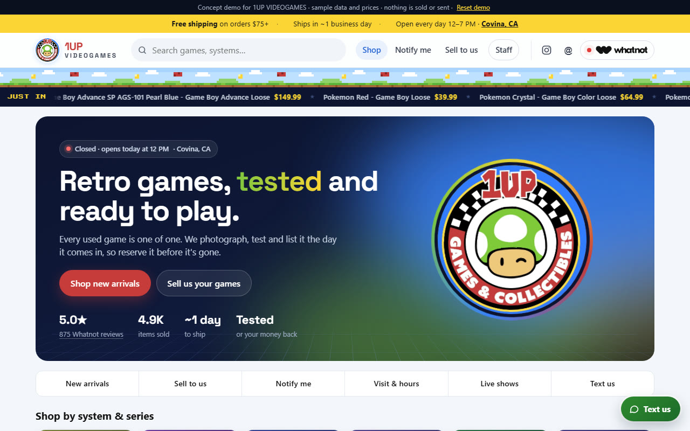
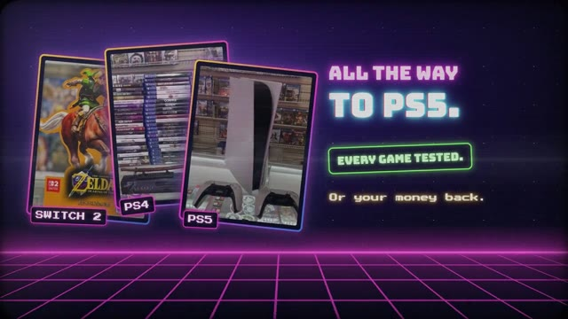
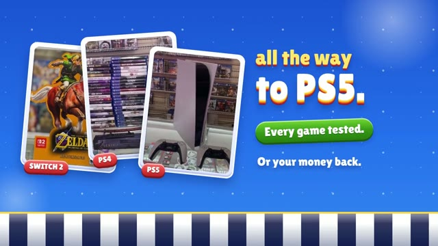
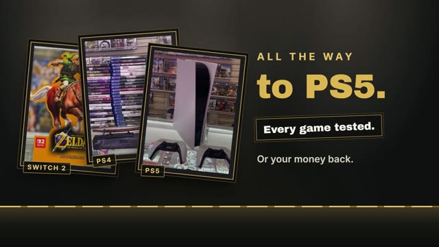
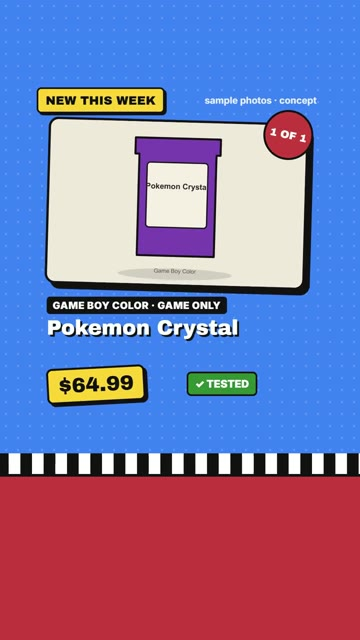

# 1UP VIDEOGAMES – photo-to-listing prototype (concept demo)

A clickable, local-only prototype of an idea for a retro game store: staff keep their
current habit of snapping a photo, and each photo becomes a full web listing
(AI-drafted, staff-approved) with a ready-to-post social caption and wishlist alerts.

> **Concept demo – not an official 1UP VIDEOGAMES site.** Sample data, generated
> placeholder photos, made-up prices. Nothing is sold, posted or sent. Shared publicly
> as a portfolio piece with the store owner's OK.

**Live demo:** https://jacobdvaldez.github.io/1up-photo-to-listing-demo/

Built by [Jacob (Jake) Valdez](https://github.com/JacobDValdez) with plain HTML, CSS and
JavaScript (no frameworks, no build step).



## Video work for 1UP

Three intro styles for the store's videos plus a vertical "New this week" reel for social media.
The music is an original Game Boy-style chiptune made in code.
**[▶ Watch all four videos](https://jacobdvaldez.github.io/1up-photo-to-listing-demo/videos.html)**

| Neon CRT | Glossy | Showcase | Reel |
|---|---|---|---|
| [](https://jacobdvaldez.github.io/1up-photo-to-listing-demo/videos.html) | [](https://jacobdvaldez.github.io/1up-photo-to-listing-demo/videos.html) | [](https://jacobdvaldez.github.io/1up-photo-to-listing-demo/videos.html) | [](https://jacobdvaldez.github.io/1up-photo-to-listing-demo/videos.html) |

## Run it

Option A – no install: double-click `index.html`.

Option B – local server (needed to open it on your phone over Wi-Fi):

```powershell
node serve.js
```

Then open http://localhost:5173 (on a phone: `http://<your-PC-IP>:5173`, and allow Node through the firewall).
`.claude/launch.json` has the same command for Claude's preview browser.

Data lives in your browser's localStorage. **Reset demo** (top banner) restores the sample data.

## Demo walkthrough (about 2 minutes)

1. **Staff: Add item** → take/choose 1–7 photos or drag them in. No photos handy?
   Open "Simulate one", pick **Pokemon Gold**, click *Add sample photos*.
2. **Draft the listing** → title (`[Game] - [System] [Loose/CIB]`), system, category,
   condition, description, alt text, shipping weight (from a per-category template),
   suggested price + price-guide reference, and a spec/trust box (e.g. GBA SP model
   AGS-001 vs AGS-101, shell, battery; carts: save battery, original label, tested + date).
   Switch Loose → CIB and watch title, price and weight update.
3. **Approve & publish** → the item is live, the Instagram/Threads caption is ready to
   copy, and the seeded "Pokemon Gold under $60" wishlist alert fires (shown as the email
   that would be sent).
4. **Shop** → New Arrivals grid, filters (system, Loose/CIB, condition, max price, search),
   product page with gallery, spec box and "Tested or your money back" guarantee,
   **Reserve for in-store pickup** (48h hold). Staff → *Sold* moves it to **Recently Sold**.
5. **Notify me** → save a wanted game; see the notification outbox.
6. **Trade-in** → pick system, game, Loose/CIB, condition → cash vs store credit.

## Listing vocabulary

Labels follow wording common in the US retro market (reviewed against a large
retro retailer's site for terms only; no content copied):

- **Completeness:** "Game Only" (title code `Loose`) and "Complete in Box" (title code `CIB`).
  Titles keep the short code: `[Game] - [System] [Loose/CIB]`.
- **Condition grades (all tested working):** Good, Acceptable, Cosmetically Flawed.
- **Trust box:** 100% authentic (board checked), deep cleaned, save battery holds / replaced,
  label original / worn / ripped-faded-missing / reproduction, original vs aftermarket shell,
  IPS screen mod, region NTSC (US).
- **System names:** Super Nintendo, Nintendo 64, Game Boy / Game Boy Color / Game Boy Advance.
- The warranty length shown ("30-day") is a placeholder: use 1UP's real policy.

All of these live in `js/catalog.js`, so the store can rename them in one place.

## Files

| File | What |
|---|---|
| `index.html`, `css/styles.css` | Shell and styles (mobile-first, plain HTML/CSS/JS, no build step) |
| `js/catalog.js` | Sample catalog, systems, condition grades, **spec templates** and **weight templates** |
| `js/ai.js` | **Pluggable AI layer** – mock by default; marked spots for the real vision call and price lookup |
| `js/app.js` | Storage, storefront, staff flow, captions, wishlist matching, trade-in |
| `serve.js` | Zero-dependency static server |

## The mock AI (be clear about this when showing it)

The mock does **not** look at photo pixels. It matches the staff hint and photo file names
against ~30 games in `catalog.js`. With an unrecognized photo (e.g. `IMG_4821.jpg`) and no
hint it shows low confidence and staff pick the item from the "Identified as" list.

## What production would need

1. **Real vision model (Claude API)** – replace `identifyFromPhotos()` in `js/ai.js`.
   Photos go to a small backend (serverless function) that calls the Claude Messages API
   with the images and asks for structured JSON (game, system, Loose/CIB, condition,
   visible flaws, model number, confidence). **API keys live only on the server**, never
   in browser code. Staff still approve every listing.
2. **Price guide** – the demo already links staff to live PriceCharting search results
   (draft screen, product page, and **Quick price check** on the staff page). That costs
   nothing. To show live numbers *inside* the tool, replace `lookupMarketPrice()` with a
   backend call to PriceCharting's paid API (subscription + token, prices returned in
   pennies; see comments in `js/ai.js`). Blend with the store's own sales history and
   apply the store's pricing rule on top. Don't scrape the site; use the API.
   An **eBay sold** button sits next to each PriceCharting button and opens eBay's
   completed + sold listings for the item (eBay may ask staff to sign in). eBay's
   sold-price API (Marketplace Insights) is limited to approved partners, so in-tool
   eBay numbers would need eBay's approval; the link works today for free.
3. **Shopify Admin API sync** – on approve, create a product (title, description/body HTML,
   images with alt text, variant price, weight, SKU, inventory quantity 1, tags for system /
   Loose-CIB / condition, metafields for the spec box). The storefront here would become a
   Shopify theme (or headless storefront) reading those fields. Mark sold = inventory 0,
   moved to a "Recently Sold" collection.
4. **POS inventory sync** – one-of-one items must sell exactly once. Use Shopify POS at the
   counter (same inventory) or sync the existing POS via webhooks; reservations should
   decrement available stock and auto-release after 48h.
5. **Social posting** – Instagram Graph API / Threads API (business account + Meta app review),
   or keep the copy-caption button plus a scheduler.
6. **Wishlist alerts** – an SMS provider (e.g. Twilio) and/or email (e.g. Shopify Email,
   Klaviyo, Postmark) with explicit opt-in, STOP/unsubscribe handling, and rate limits.
   Matching should use catalog IDs rather than text.
7. **Trade-in** – real buy rates set by the store; quote form sends a lead to staff.
8. **Accounts & hosting** – staff login for the Add-item screen, image storage/CDN,
   backups, and photo resizing on upload.
